# Кратко

Мы построили связку из трёх частей, работающих ежемесячно на данных, известных к концу месяца: **прогноз** безналичных расходов на жителя для 12 096 полных рядов (2 190 МО, 6 категорий) на 1–12 месяцев, **детектор структурных изменений**, который сигнализирует о шоке в момент его появления, и **новостной контур**, который привязывает заголовки к субъектам и муниципалитетам и объясняет шоки.

- **Прогноз.** Итоговая модель — Ансамбль (5 вариантов LightGBM и 2 сезонные модели с онлайн-весами). Относительно базовой модели Prophet MAE ниже на 45,6% / 28,4% / 16,3% / 46,3% для горизонтов 1 / 3 / 6 / 12 мес. (326,0 / 405,3 / 496,1 / 480,7 руб. на жителя против 599,5 / 566,2 / 592,5 / 894,3). Преимущество статистически значимо на всех горизонтах (парный тест Уилкоксона по рядам, p < 10⁻¹⁰).
- **Фундаментальные модели.** Chronos-2 и Chronos-Bolt в режиме zero-shot на 12–23 точках истории уступают даже простым сезонным моделям: им не хватает полного сезонного цикла. Помогают три приёма: очистка ряда от сезонности по 7-летнему общероссийскому ряду СберИндекса, ковариаты (длинная история РФ, календарь) и использование Chronos-2 как источника признаков и прогнозных интервалов. Лучшее применение фундаментальной модели в нашей задаче — **детектор шоков**: выход факта за 95%-интервал Chronos-2 даёт лучший F1 среди онлайн-методов (0,525) при обнаружении в том же месяце.
- **Точки изменений.** На синтетическом бенчмарке с известной разметкой (3 типа × 3 величины шока) сравнены 9 методов и 3 двухуровневые схемы. Для мониторинга выбрана схема «Chronos-2 сигнализирует → PELT/BinSeg подтверждает»: точность 0,83, 0,11 ложной тревоги на 100 ряд-месяцев.
- **Новости.** Собрано 385 970 заголовков (Интерфакс, Lenta.ru, дек. 2022 – дек. 2024), 10,5% привязаны к субъекту РФ, 2,1% — к конкретному МО. Event study показывает реакцию расходов на ЧС: в месяц события «Маркетплейсы» −3,7 п.п. (на границе значимости), через месяц «Здоровье» −1,8 п.п., через два месяца «Все категории» +1,3 п.п. (восстановительные траты). Как массовый признак прогноза новости точность не улучшили: события редки и затрагивают около 1% МО-месяцев. Их роль — объяснение и адресный мониторинг шоков.
- **Находки в данных.** (1) В апреле 2023 г. произошёл синхронный сдвиг «город — село»: в районах расходы на здоровье, общепит и транспорт упали на 11–23% к марту, а в городах федерального значения не изменились или выросли; новостного следа нет, это общегрупповой, вероятно методологический или платёжно-поведенческий сдвиг. (2) Паводок 2024 г. в Орске проявился не в общих расходах, а в их структуре.

# 1. Данные

## 1.1. Датасет конкурса

Безналичные потребительские расходы на жителя МО (руб./мес.), январь 2023 – декабрь 2024, 2 190 МО (в постоянных границах), 6 категорий. Всего 303 126 наблюдений и 13 140 рядов, из них 12 096 полных (24 месяца) составляют бенчмарк. Восемь приграничных субъектов (Белгородская, Брянская, Воронежская, Курская, Ростовская области, Краснодарский край, Крым, Севастополь) в датасете отсутствуют. Также использованы индекс доступности рынков (статический признак МО) и матрица дорожных расстояний (5,9 млн пар) — по ней для каждого МО определены 8 ближайших соседей.

## 1.2. Внешние открытые источники

| Источник | Что взято | Разрез | Лицензия / доступ |
|---|---|---|---|
| СберИндекс: справочник МО | версии МО, ОКТМО, субъект, координаты центра | МО | CC BY-SA 4.0 |
| СберИндекс API (sberindex.ru) | потребительские расходы РФ по типам с 12.2018, медианные зарплаты, обороты бизнеса, инфляция SA | РФ, мес. | открытые данные сайта |
| Росстат | ИПЦ (всего, продовольствие, непрод., услуги), зарплаты, задолженность по зарплате | субъект, мес. | открытые таблицы rosstat.gov.ru |
| Росстат | численность населения МО на 01.01.2023–2025, городское население, моногорода | МО | открытые таблицы |
| Банк России | ключевая ставка | РФ, день → мес. | cbr.ru |
| Производственный календарь | рабочие, выходные, праздничные дни | РФ, мес. | isdayoff.ru |
| NASA POWER (MERRA-2) | температура, осадки, снежный покров, аномалии к норме 2018–2022 | центр МО, мес. | открытые данные NASA |
| Интерфакс, Lenta.ru | 385 970 заголовков (только метаданные: дата, заголовок, рубрика) | новость → субъект/МО | суточные архивы, разрешены robots.txt |

Сырые данные в репозиторий не включаются; `scripts/01_download_data.py` скачивает их из первоисточников, проверка TLS не отключается (для сайтов с сертификатами НУЦ Минцифры используется bundle из папки `certs/`).

## 1.3. Особенности, определившие методологию

1. **Короткие ряды.** 24 точки: для прогноза из декабря 2023 г. у модели есть ровно один год истории, т.е. ни одного полного сезонного цикла с «годом назад». Отсюда главный приём: сезонный профиль берётся из **общероссийского ряда СберИндекса за 2019–2023 гг.** (медиана лог-отклонений от центрированного скользящего среднего; 2020 г. исключён из-за локдауна), а оценка обновляется только по данным до точки прогноза.
2. **Сильная сезонность и тренд.** Декабрь +15–19% к среднему уровню, январь–февраль −5–10%; номинальный рост 10–15% г/г, у маркетплейсов до 60%.
3. **Неоднородность.** Уровни расходов различаются между МО в 3–4 раза, поэтому R² по уровням тривиально близок к 1. Мы дополнительно считаем **R² динамики** (R² по лог-приросту от точки прогноза) — он показывает, какую долю изменений модель объясняет.

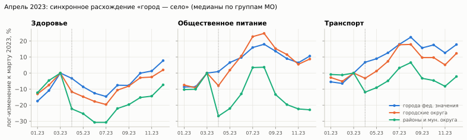

# 2. Постановка эксперимента

- **Скользящая точка прогноза** (rolling origin, расширяющееся окно): T = 2023-12, 2024-01, …, 2024-11. Модель видит только данные ≤ T и прогнозирует шаги h = 1…min(12, 2024-12 − T).
- **Горизонты 1, 3, 6, 12 мес.** оцениваются как средняя ошибка на шагах 1…H по всем точкам T, для которых окно целиком лежит в данных (H = 12 — прогноз всего 2024 г. из декабря 2023 г.). Дополнительно приводится ошибка по каждому шагу h.
- **Метрики.** MAE (руб./жителя, основная), R² по уровням, R² динамики, RMSE, WAPE, MAPE, sMAPE, MASE. Значимость отличий от Prophet — парный критерий Уилкоксона и бутстреп-интервал разности MAE по рядам (ошибки усредняются внутри ряда, что снимает зависимость между точками прогноза одного ряда).
- **Защита от утечки.** В бэктесте модель получает копию матрицы, где все значения после T заменены на пропуски; внешние ряды фильтруются по дате публикации (as-of). Новости относятся к месяцу публикации и используются только до конца месяца T.

# 3. Прогнозирование

## 3.1. Модели

| Группа | Модель | Идея |
|---|---|---|
| Эталоны | Naive, SeasonalNaive | последнее значение; значение год назад |
| Сезонные | SNaive×Growth | значение год назад × медианный темп роста г/г за 3 мес.; при отсутствии истории — темп РФ |
| | NatSeasonal | последний уровень × сезонный профиль РФ × тренд г/г |
| Базовая организаторов | **Prophet** | настройки по умолчанию; при истории < 2 лет годовая сезонность отключается автоматически |
| Статистические | ETS-SA, Theta-SA | AutoETS / AutoTheta по ряду, очищенному от национальной сезонности |
| Глобальная ML | **LightGBM** | одна модель для всех рядов и горизонтов (прямой многошаговый прогноз), цель — лог-прирост, база — национальная сезонность (init_score) |
| Фундаментальные | Chronos-Bolt, Chronos-2 | zero-shot; варианты: очистка от сезонности (SA), ковариаты (ряд РФ с 2019 г., календарь, сезонный профиль), cross-learning по субъекту, дообучение LoRA |
| Гибриды | LightGBM + Chronos-2 | прогноз и ширина интервала Chronos-2 из каждой исторической точки — признаки бустинга |
| | **Ансамбль** | варианты LightGBM (5 наборов признаков) + SNaive×Growth + NatSeasonal; веса ∝ 1/MAE прошлых прогнозов, чьи факты известны к моменту T (по категории и ближайшему шагу h; на первой точке — по прогнозам из валидационных точек июня–ноября 2023 г.) |

Признаки LightGBM (101 шт.): собственная история (лаги, очищенные от сезонности и исходные, «якорь» год назад, приросты г/г), национальный сезонный профиль и прирост СберИндекса, панельные медианы по категории и субъекту, ИПЦ/зарплаты/задолженность субъекта, ключевая ставка, характеристики МО (население, урбанизация, доступность рынков, моногород, координаты), календарь целевого месяца, погодные аномалии, динамика соседей по дорогам, **признаки детектора изменений на момент T** и **новостные индексы**. Вес наблюдения равен уровню ряда: L1-потеря по лог-приросту, взвешенная уровнем, приближает MAE в рублях — модель оптимизирует ту же метрику, что и оценка.

## 3.2. Результаты

Таблица 1. Качество прогноза (MAE — руб. на жителя в месяц; R² динамики — по лог-приросту от точки прогноза).

| Модель | MAE 1 мес. | MAE 3 мес. | MAE 6 мес. | MAE 12 мес. | R² 1 | R² динамики 1 | R² 12 | R² динамики 12 |
|---|--:|--:|--:|--:|--:|--:|--:|--:|
| **Ансамбль** | 326,0 | 405,3 | 496,1 | 480,7 | 0,997 | 0,46 | 0,995 | 0,48 |
| Э1: топ-4 по валидации 2023 г. | 360,0 | 488,8 | 609,4 | 877,8 | 0,997 | 0,41 | 0,984 | -0,06 |
| LightGBM | 374,5 | 450,7 | 540,0 | 538,9 | 0,996 | 0,39 | 0,994 | 0,39 |
| LightGBM (без новостей) | 345,6 | 422,8 | 520,4 | 530,2 | 0,997 | 0,44 | 0,994 | 0,37 |
| LightGBM (без признаков CPD) | 373,1 | 456,1 | 563,5 | 552,0 | 0,996 | 0,40 | 0,993 | 0,37 |
| LightGBM (только ряд) | 310,4 | 403,9 | 533,7 | 557,6 | 0,998 | 0,47 | 0,993 | 0,39 |
| LightGBM + Chronos-2 (стэкинг) | 364,4 | 444,5 | 543,6 | 529,4 | 0,997 | 0,41 | 0,994 | 0,40 |
| SNaive×Growth | 388,8 | 463,7 | 536,7 | 552,4 | 0,996 | -0,28 | 0,993 | 0,04 |
| NatSeasonal | 439,4 | 541,8 | 593,4 | 550,7 | 0,995 | 0,16 | 0,993 | 0,42 |
| Theta-SA | 408,9 | 550,8 | 655,2 | 898,2 | 0,996 | 0,26 | 0,982 | -0,25 |
| ETS-SA | 428,8 | 587,9 | 703,3 | 1 011,4 | 0,995 | 0,21 | 0,976 | -0,05 |
| Chronos-2-SA + ковариаты + LoRA | 1 105,5 | 1 102,3 | 1 571,3 | 914,5 | 0,676 | -4,98 | 0,980 | 0,15 |
| Chronos-2-SA + ковариаты | 409,1 | 564,2 | 698,2 | 1 117,3 | 0,996 | 0,33 | 0,972 | -0,30 |
| Chronos-2-SA | 412,6 | 590,6 | 730,7 | 1 161,1 | 0,995 | 0,29 | 0,970 | -0,53 |
| Chronos-2 + ковариаты | 594,7 | 664,8 | 821,7 | 1 095,7 | 0,990 | 0,17 | 0,971 | -0,17 |
| Chronos-2 | 652,0 | 721,9 | 913,4 | 1 119,9 | 0,987 | 0,05 | 0,968 | -0,43 |
| Chronos-Bolt-SA | 426,9 | 596,6 | 765,1 | 1 239,9 | 0,995 | 0,28 | 0,965 | -0,73 |
| Chronos-Bolt | 704,6 | 739,3 | 931,1 | 1 095,3 | 0,985 | 0,00 | 0,966 | -0,59 |
| **Prophet** | 599,5 | 566,2 | 592,5 | 894,3 | 0,990 | -0,32 | 0,978 | -1,81 |
| Naive | 675,3 | 718,0 | 807,5 | 936,1 | 0,984 | -0,01 | 0,978 | -0,00 |
| SeasonalNaive | 1 266,1 | 1 298,1 | 1 322,8 | 1 266,1 | 0,967 | -3,55 | 0,967 | -0,78 |

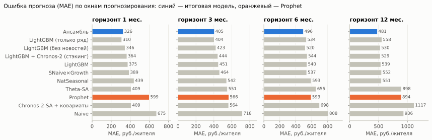

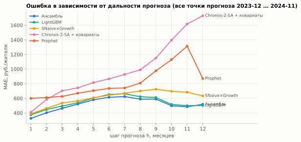

Таблица 2. Ансамбль против Prophet: парное сравнение по рядам.

| Окно | Разность MAE | 95% ДИ | p (Уилкоксон) | Доля рядов, где лучше |
|---|--:|--:|--:|--:|
| 1 мес. | -273,5 | [-279,9; -267,1] | < 10⁻¹⁰ | 96,0% |
| 3 мес. | -160,9 | [-165,7; -156,0] | < 10⁻¹⁰ | 91,5% |
| 6 мес. | -96,4 | [-101,2; -91,4] | < 10⁻¹⁰ | 78,0% |
| 12 мес. | -413,6 | [-429,4; -397,9] | < 10⁻¹⁰ | 80,4% |

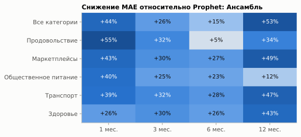

**Почему Prophet проигрывает.** При 12–23 точках Prophet отключает годовую сезонность и экстраполирует кусочно-линейный тренд: декабрьский всплеск в конце истории тянет тренд вверх, январский прогноз завышается, а прогноз на 12 мес. продолжает тренд без сезонного профиля. Модели, получающие сезонность извне (из ряда РФ или из прошлого года), исправляют именно это.

## 3.3. Фундаментальные модели: преимущества и ограничения

Таблица 3. Фундаментальные модели в разных режимах (для сравнения — SNaive×Growth и Prophet).

| Модель | MAE 1 мес. | MAE 3 мес. | MAE 6 мес. | MAE 12 мес. |
|---|--:|--:|--:|--:|
| Chronos-Bolt | 704,6 | 739,3 | 931,1 | 1 095,3 |
| Chronos-Bolt-SA | 426,9 | 596,6 | 765,1 | 1 239,9 |
| Chronos-2 | 652,0 | 721,9 | 913,4 | 1 119,9 |
| Chronos-2-SA | 412,6 | 590,6 | 730,7 | 1 161,1 |
| Chronos-2 + ковариаты | 594,7 | 664,8 | 821,7 | 1 095,7 |
| Chronos-2-SA + ковариаты | 409,1 | 564,2 | 698,2 | 1 117,3 |
| Chronos-2-SA + ковариаты + LoRA | 1 105,5 | 1 102,3 | 1 571,3 | 914,5 |
| LightGBM + Chronos-2 (стэкинг) | 364,4 | 444,5 | 543,6 | 529,4 |
| SNaive×Growth | 388,8 | 463,7 | 536,7 | 552,4 |
| Prophet | 599,5 | 566,2 | 592,5 | 894,3 |

- **Ограничение.** Chronos-Bolt и Chronos-2 без адаптации видят 12–23 точки и не могут восстановить годовой цикл. Ошибка на 12 мес. у них выше, чем у сезонного наивного прогноза с поправкой на рост.
- **Что помогает.** Очистка от сезонности по ряду РФ снижает ошибку Chronos-2 на 1 мес. на 37%; ковариаты с длинной историей РФ и cross-learning по субъекту снижают её ещё на 1–5%. Прогноз Chronos-2 как признак LightGBM (стэкинг) даёт небольшой выигрыш на 1, 3 и 12 мес. (−1…3%).
- **Что не помогло.** LoRA-дообучение (300 шагов, шаг обучения 10⁻⁴, окна до 6 мес.) оказалось нестабильным: ошибка на 1–6 мес. выросла в 2–3 раза, на 12 мес. снизилась на 18% относительно zero-shot. Вероятные причины — короткие ряды и длинное заполнение пропусками до 2019 г.; нужна ранняя остановка по валидации и меньший шаг.
- **Где фундаментальная модель сильнее всего.** Калиброванные прогнозные интервалы Chronos-2 — лучший онлайн-детектор шоков (раздел 4).

## 3.4. Вклад групп признаков и абляции

Таблица 4. Абляции LightGBM: вклад групп признаков.

| Вариант | MAE 1 мес. | MAE 3 мес. | MAE 6 мес. | MAE 12 мес. |
|---|--:|--:|--:|--:|
| LightGBM | 374,5 | 450,7 | 540,0 | 538,9 |
| LightGBM (без новостей) | 345,6 | 422,8 | 520,4 | 530,2 |
| LightGBM (без признаков CPD) | 373,1 | 456,1 | 563,5 | 552,0 |
| LightGBM (только ряд) | 310,4 | 403,9 | 533,7 | 557,6 |
| LightGBM + Chronos-2 (стэкинг) | 364,4 | 444,5 | 543,6 | 529,4 |

- **Короткие горизонты (1–3 мес.)** лучше всего прогнозирует LightGBM только по собственной истории ряда с национальным сезонным профилем как базой: внешние признаки на коротком горизонте добавляют шум.
- **Дальние горизонты (6–12 мес.)** выигрывают от региональных и макропризнаков, календаря, погоды и соседей: ошибка на 12 мес. ниже, чем у варианта «только ряд».
- **Признаки детектора изменений** (давность и величина последнего сдвига, вероятность смены режима на момент T) снижают MAE на 6 и 12 мес. на 4% и 2% (вариант «LightGBM» против «без признаков CPD»): так связка «детектор → прогноз» работает на практике. Вероятный механизм — после найденного сдвига модель меньше доверяет значению год назад.
- **Новостные признаки** в бустинге ухудшают MAE: события редки, а индексы по субъекту в сочетании с региональными признаками позволяют деревьям запомнить случайные региональные колебания обучающего периода. Поэтому новости используются прежде всего для объяснения шоков и в детекторе; в ансамбле вариант с новостями — один из пяти вариантов LightGBM.

## 3.5. Ансамбль и анализ чувствительности

Итоговый ансамбль объединяет модели, обучаемые на панели, и сезонные модели. Средние веса: LightGBM — 0,14; LightGBM (без новостей) — 0,14; LightGBM (без признаков CPD) — 0,14; LightGBM (только ряд) — 0,14; LightGBM + Chronos-2 (стэкинг) — 0,14; SNaive×Growth — 0,15; NatSeasonal — 0,16 — они почти равны, т.е. ансамбль близок к простому среднему.

Таблица 5. Варианты ансамбля (для сравнения — лучшая одиночная модель и Prophet).

| Схема | MAE 1 мес. | MAE 3 мес. | MAE 6 мес. | MAE 12 мес. |
|---|--:|--:|--:|--:|
| Ансамбль | 326,0 | 405,3 | 496,1 | 480,7 |
| Э1: топ-4 по валидации 2023 г. | 360,0 | 488,8 | 609,4 | 877,8 |
| Э2: все кандидаты, 1/MAE | 341,0 | 442,2 | 532,1 | 606,7 |
| Э3: онлайн-выбор топ-4 | 342,6 | 473,5 | 602,6 | 635,6 |
| Э4: медиана кандидатов | 347,0 | 439,1 | 530,1 | 547,6 |
| LightGBM (без новостей) | 345,6 | 422,8 | 520,4 | 530,2 |
| Prophet | 599,5 | 566,2 | 592,5 | 894,3 |

Сначала мы выбирали участников по MAE на валидационных точках июня–ноября 2023 г. (вариант Э1). Это не сработало: в середине 2023 г. у LightGBM ещё мало данных для обучения, а горизонты валидации не длиннее 6 мес., поэтому отбор предпочёл фундаментальные модели, которые плохо прогнозируют на 12 мес. Итоговая схема выбрана после сравнения вариантов на тех же данных бэктеста; таблица показывает, насколько результат зависит от этого выбора. Варианты Э2 и Э4 и лучшая одиночная модель (LightGBM без новостей) тоже лучше Prophet на всех горизонтах; Э1 и Э3 проигрывают ему на дальних горизонтах, потому что отбирают фундаментальные модели.

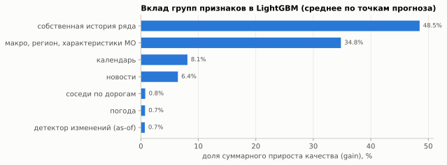

# 4. Обнаружение точек структурных изменений

## 4.1. Сигнал

Для каждого ряда строится **относительный индекс** x_t = log y_t − медиана log y_t по группе сопоставимых МО (та же категория и тот же тип поселения: города федерального значения / городские округа / районы и муниципальные округа). Общая сезонность, инфляция, тренд и общегрупповые сдвиги (как в апреле 2023 г.) сокращаются, а локальный шок превращается в сдвиг уровня. Медианный разброс индекса от месяца к месяцу около 4%.

## 4.2. Методы и протокол

- **Офлайн** (ретроспективная сегментация, библиотека ruptures): PELT, BinSeg, BottomUp (L2), Window, KernelCPD (RBF). Штраф = c · log n на стандартизованном ряде.
- **Онлайн**: двусторонний CUSUM, Page–Hinkley, BOCPD (Adams & MacKay, 2007; нормальная модель с сопряжённым NIG-априором), BOCPD с новостным hazard, **выход за прогнозный интервал Chronos-2** (одношаговый прогноз x_t по x_1…x_{t−1}).
- **Двухуровневые схемы**: сигнал Chronos-2 подтверждается PELT, BinSeg или BOCPD в пределах месяца.
- **Синтетический бенчмарк.** В реальные ряды индекса вносятся шоки: сдвиг уровня, постепенный сдвиг за 4 месяца, временный шок на 3 месяца; величина 10/20/35%; 25% рядов без шока (для оценки ложных тревог). Параметры каждого метода подбираются по F1 на 1 200 валидационных рядах, метрики считаются на 3 000 тестовых.
- **Два режима оценки**: ретроспектива (метод видит весь ряд) и ежемесячный мониторинг (в месяц t метод видит только x_1…x_t; так измеряются задержка и ложные тревоги). Метрики: precision, recall, F1 с допуском ±1 мес., Covering (van den Burg & Williams, 2020), средняя задержка, доля обнаруженных за ≤ 1 мес., ложные тревоги на 100 ряд-месяцев без шока.

## 4.3. Результаты

Таблица 6. Сравнение детекторов на синтетическом тесте (3 000 рядов; параметры подобраны на валидации).

| Метод | Режим | Precision | Recall | F1 | Ложные тревоги / 100 мес. | Задержка, мес. | Covering |
|---|--:|--:|--:|--:|--:|--:|--:|
| PELT | ретроспектива | 0,46 | 0,52 | 0,491 | 1,87 | — | 0,807 |
| PELT | мониторинг | 0,48 | 0,54 | 0,513 | 1,62 | 0,88 | — |
| BinSeg | ретроспектива | 0,47 | 0,49 | 0,480 | 1,82 | — | 0,801 |
| BinSeg | мониторинг | 0,49 | 0,54 | 0,515 | 1,61 | 0,89 | — |
| BottomUp | ретроспектива | 0,42 | 0,47 | 0,446 | 1,82 | — | 0,790 |
| BottomUp | мониторинг | 0,39 | 0,54 | 0,451 | 1,80 | 1,46 | — |
| Window | ретроспектива | 0,24 | 0,59 | 0,337 | 11,08 | — | 0,669 |
| KernelCPD (RBF) | ретроспектива | 0,40 | 0,44 | 0,419 | 3,54 | — | 0,774 |
| KernelCPD (RBF) | мониторинг | 0,48 | 0,56 | 0,516 | 2,76 | 1,61 | — |
| CUSUM | ретроспектива | 0,27 | 0,43 | 0,327 | 4,21 | — | 0,729 |
| CUSUM | мониторинг | 0,27 | 0,43 | 0,327 | 4,21 | 0,29 | — |
| Page–Hinkley | ретроспектива | 0,27 | 0,55 | 0,364 | 5,86 | — | 0,729 |
| Page–Hinkley | мониторинг | 0,27 | 0,55 | 0,364 | 5,86 | 0,26 | — |
| BOCPD | ретроспектива | 0,57 | 0,41 | 0,477 | 1,19 | — | 0,784 |
| BOCPD | мониторинг | 0,57 | 0,41 | 0,477 | 1,19 | 0,05 | — |
| Chronos-2 интервал (q0.05–q0.95) | мониторинг | 0,33 | 0,70 | 0,447 | 7,18 | 0,00 | — |
| Chronos-2 интервал (q0.025–q0.975) | мониторинг | 0,69 | 0,42 | 0,525 | 0,79 | 0,01 | — |
| Chronos-2 → PELT | мониторинг | 0,83 | 0,35 | 0,495 | 0,11 | 0,49 | — |
| Chronos-2 → BOCPD | мониторинг | 0,83 | 0,34 | 0,485 | 0,20 | 0,01 | — |
| Chronos-2 → BinSeg | мониторинг | 0,84 | 0,35 | 0,496 | 0,11 | 0,49 | — |

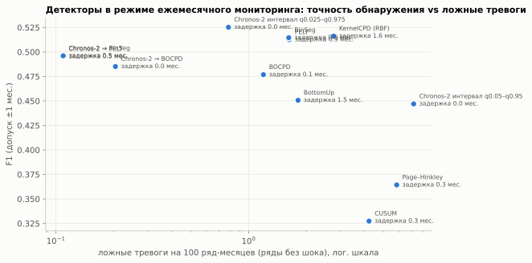

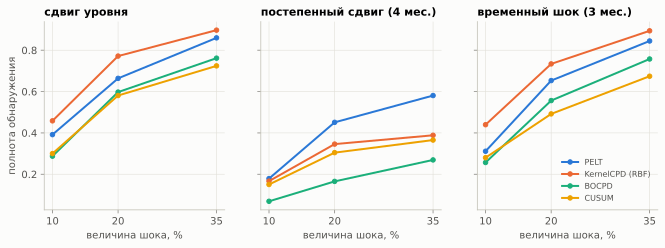

**Выбор.** Для ежемесячного мониторинга — двухуровневая схема: Chronos-2 даёт сигнал в месяц шока, PELT/BinSeg подтверждает сдвиг. Если важна полнота, а лишние проверки дёшевы, используется только интервал Chronos-2 (q2.5–q97.5). Для ретроспективной разметки — консенсус ≥ 3 из 5 офлайн-методов. Window в режиме мониторинга неприменим по построению (нужна половина окна после точки изменения); BOCPD даёт меньше всего ложных тревог, но пропускает постепенные сдвиги.

## 4.4. Реальные данные

- Консенсус ≥ 3 из 5 офлайн-методов находит 4 380 точек изменений, из них 2 138 со сдвигом ≥ 10%. Крупные сдвиги чаще всего происходят в общепите, транспорте и маркетплейсах: это небольшие по объёму и самые волатильные категории.
- **Орск.** BOCPD подаёт тревогу в апреле 2024 г. по «Маркетплейсам» и «Здоровью»; вариант с новостным hazard дополнительно отмечает май 2024 г. в «Общественном питании» — месяц отскока.
- **Раннее предупреждение.** Классификатор вероятности шока в следующем месяце (|отклонение индекса| > max(10%, 4σ)) обучен на 2023 – марте 2024 г. и проверен на апреле – декабре 2024 г.: ROC-AUC 0,855, доля шоков 1,5%, точность среди 1% самых рискованных МО-месяцев 21,8% (в 14 раз выше базовой частоты). Главные предикторы: собственная волатильность, недавние отклонения, размер МО, доля шоков у соседей и в субъекте.

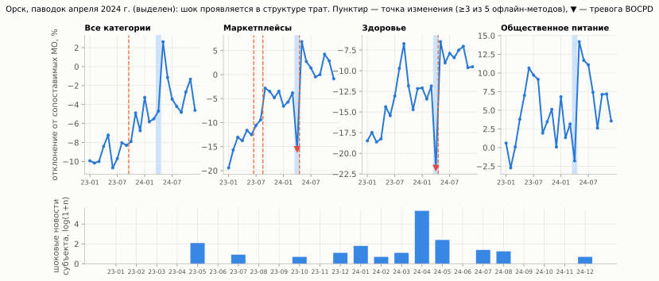

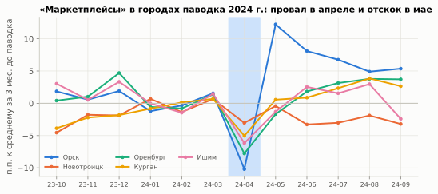

# 5. Интеграция новостей

## 5.1. Механизм согласования

1. **Сбор.** Суточные архивы Интерфакса и Lenta.ru за декабрь 2022 – декабрь 2024 г.; сохраняются только дата и время, заголовок, рубрика и ссылка.
2. **Нормализация.** Токены заголовка приводятся к леммам (pymorphy3).
3. **Геопривязка по газетиру из справочника СберИндекса.** Субъект распознаётся по полному названию, собственному имени («Кузбасс», «Югра»), административному центру и устойчивым синонимам («Кубань», «Подмосковье»), в том числе в перечислениях («над Белгородской и Тульской областями»). МО — по форме «<прилагательное> район/округ» или по городу-центру; если город — центр и городского округа, и района, приоритет у городского округа. Неоднозначные имена (есть в нескольких субъектах или совпадают с обычными словами) засчитываются только при упоминании своего субъекта в том же заголовке.
4. **Классификация.** Словари лемм для типов событий: безопасность, ЧС и стихия, коммунальные аварии, негатив и позитив в экономике, эпидемии; отраслевые темы сопоставлены категориям трат (маркетплейсы, топливо и транспорт, лекарства, общепит, продукты).
5. **Временное согласование (as-of).** Новость относится к месяцу публикации по Москве. Признак для прогноза из точки T использует новости, опубликованные до конца T; для раннего предупреждения о шоке в месяце t+1 — новости до t.
6. **Пространственное согласование.** МО получает собственные упоминания, индексы своего субъекта и общероссийские отраслевые новости своей категории трат.
7. **Нормировка.** log(1 + n) и «новостной сюрприз» — отклонение от средней за 6 предыдущих месяцев (только прошлые месяцы).

Новостные индексы используются в трёх местах: как признаки LightGBM, как ковариата Chronos-2 и как множитель априорной вероятности смены режима в BOCPD (h_t = h_0 · (1 + β · событие_t)).

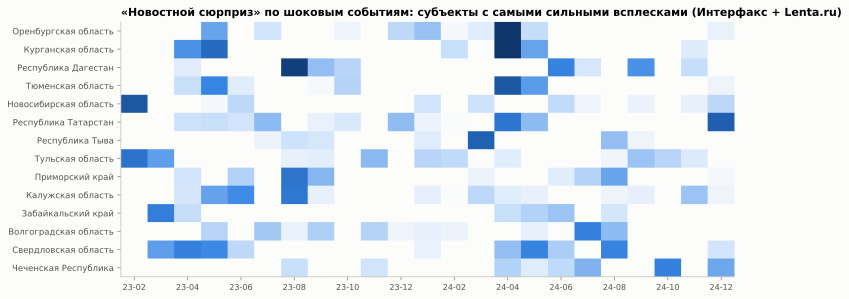

## 5.2. Что показывают новости

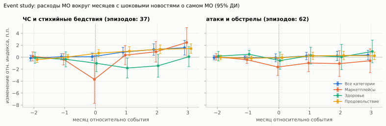

Таблица 7. Изменение относительного индекса, п.п. [95% ДИ], относительно среднего за 3 месяца до события.

| Тип события | Категория | Месяц события | +1 мес. | +2 мес. |
|---|--:|--:|--:|--:|
| ЧС, стихия | Все категории | 0,1 [-0,5; 0,7] | 0,9 [0,1; 1,7] | 1,3 [0,3; 2,2] |
| ЧС, стихия | Здоровье | -1,0 [-2,4; 0,4] | -1,8 [-3,5; -0,1] | -1,4 [-3,3; 0,5] |
| ЧС, стихия | Маркетплейсы | -3,7 [-7,7; 0,3] | 0,3 [-1,3; 1,9] | 0,9 [-0,8; 2,6] |
| ЧС, стихия | Продовольствие | 0,7 [0,1; 1,3] | 1,0 [0,3; 1,7] | 1,3 [0,6; 2,0] |
| атаки, обстрелы | Все категории | -0,1 [-0,8; 0,6] | 0,2 [-0,4; 0,8] | 0,2 [-0,6; 1,0] |
| атаки, обстрелы | Здоровье | -0,6 [-2,0; 0,9] | 0,3 [-1,1; 1,7] | 0,0 [-2,1; 2,2] |
| атаки, обстрелы | Маркетплейсы | -1,6 [-3,1; -0,2] | -1,0 [-2,4; 0,5] | -1,1 [-3,2; 1,1] |
| атаки, обстрелы | Продовольствие | -0,1 [-0,6; 0,5] | 0,2 [-0,4; 0,8] | 0,3 [-0,4; 1,0] |

- Механизм корректно выделяет реальные события: паводки апреля 2024 г. (Оренбургская, Курганская, Тюменская области), взрыв на АЗС в Махачкале (август 2023 г.), тайфун в Приморье (август 2023 г.), атаку беспилотников на Казань (декабрь 2024 г.).
- Новости объясняют, **как** меняются расходы при шоке: в месяц ЧС падают траты на маркетплейсах (сбой доставки и пунктов выдачи; эффект на границе значимости) и на здоровье, а траты на продукты и затем общие расходы растут (запасы, восстановление, выплаты пострадавшим). После атак значимо снижаются траты на маркетплейсах.
- **Влияние на метрики.** Новостные события касаются 1,4% МО-месяцев. Как признаки LightGBM новости точность не улучшили: MAE на всех прогнозах выше на 1,1%, на прогнозах для МО и месяцев с новостным событием — выше на 1,5%. В раннем предупреждении о шоках на уровне всей панели они тоже не добавили качества (ROC-AUC 0,855 → 0,854), а новостной hazard в BOCPD повысил полноту ценой точности. Причина — большинство локальных сдвигов не попадает в федеральную ленту, а федеральные новости о регионе слишком редки и шумны для массового признака.
- **Вывод.** Механизм согласования корректно связывает новости с территориями и месяцами и даёт измеримую, интерпретируемую реакцию расходов на события (event study). Его практическая ценность — объяснение сигналов детектора и адресный мониторинг МО, упомянутых в новостях. Для заметного вклада в массовый прогноз нужна региональная и муниципальная лента (региональные СМИ, каналы органов власти).

# 6. Итоговый алгоритм

Каждый месяц после публикации данных СберИндекса:

1. Обновить внешние ряды (ИПЦ, зарплаты, ставка, календарь, погода) и новостные индексы за прошедший месяц.
2. Пересчитать относительный индекс и признаки детектора на момент T.
3. **Обнаружение:** проверить выход факта за 95%-интервал прошлого прогноза Chronos-2 (сигнал), подтвердить сдвиг PELT/BinSeg, приложить новости субъекта и МО за этот месяц как объяснение.
4. **Прогноз:** пять вариантов LightGBM (включая стэкинг с Chronos-2-SA) и две сезонные модели строят прогноз на 1–12 мес.; ансамбль взвешивает их по недавним ошибкам. Признаки давности и величины найденного сдвига передаются в LightGBM.
5. **Раннее предупреждение:** вероятность шока в следующем месяце для каждого МО — список МО для проверки аналитиком.

# 7. Интерпретация и применение

- **Региональная политика и мониторинг:** список МО с подтверждённым сдвигом и сопровождающими новостями показывает, где шок локальный (паводок, авария), а где общий для группы (апрель 2023 г.).
- **Оценка последствий ЧС:** event study даёт ожидаемый профиль реакции по категориям трат, а значит, базу для оценки ущерба и восстановления (например, в Орске — отскок маркетплейсов и общепита через месяц после паводка).
- **Бизнес и банки:** прогноз спроса по категориям на 1–12 месяцев для 2 190 территорий; ошибка на 12 мес. около 5,5% от уровня (WAPE).

# 8. Ограничения

- 24 месяца данных: на 12 мес. оценка опирается на одну точку прогноза (декабрь 2023 г.). Результаты по горизонту 12 мес. менее устойчивы, чем по 1–6 мес.
- Синтетические шоки внесены в реальные ряды, где уже есть собственные сдвиги; часть «ложных тревог» в синтетике может быть настоящими изменениями.
- Федеральные ленты слабо покрывают малые МО; региональные СМИ и Telegram-каналы органов власти — следующее расширение.
- Исключённые приграничные субъекты не позволяют проверить детектор на крупнейших шоках 2024 г.

# 9. Воспроизводимость

```bash
make setup      # окружение (Python 3.12, зависимости из requirements.txt)
make data       # загрузка всех данных (≈ 1,5 ч, в основном новости; кэшируется)
make dataset news
make forecast   # бэктест всех моделей (≈ 3 ч на 8 ядрах Apple M)
make cpd        # бенчмарк детекторов и раннее предупреждение (≈ 30 мин)
make figures report
```

Все гиперпараметры — в `configs/default.yaml`; быстрый прогон на подвыборке — `configs/quick.yaml`. Случайность зафиксирована (seed = 42). Время полного прогона: ≈ 4–5 ч на ноутбуке с 8 ядрами Apple M (большая часть — бэктест Prophet и LightGBM).
